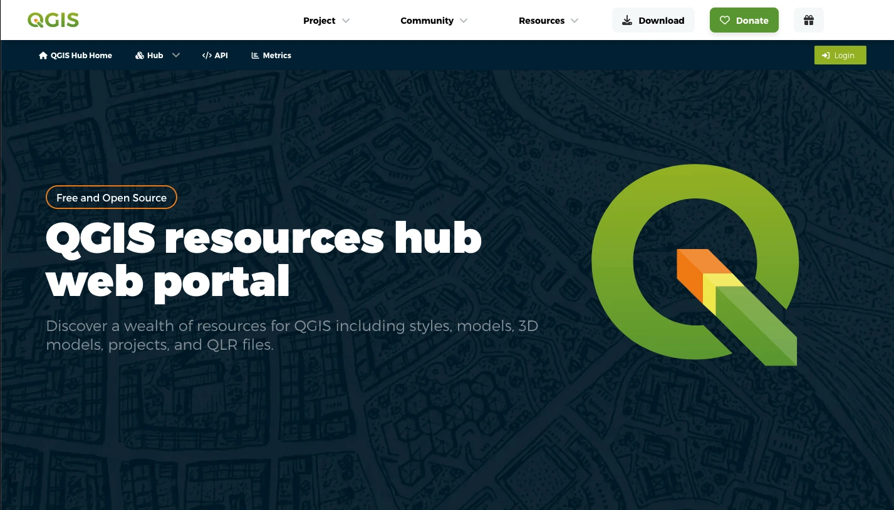
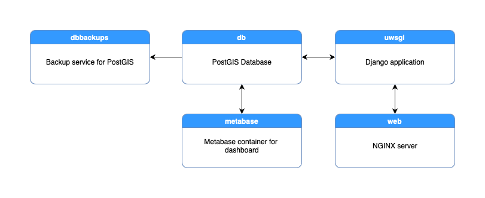
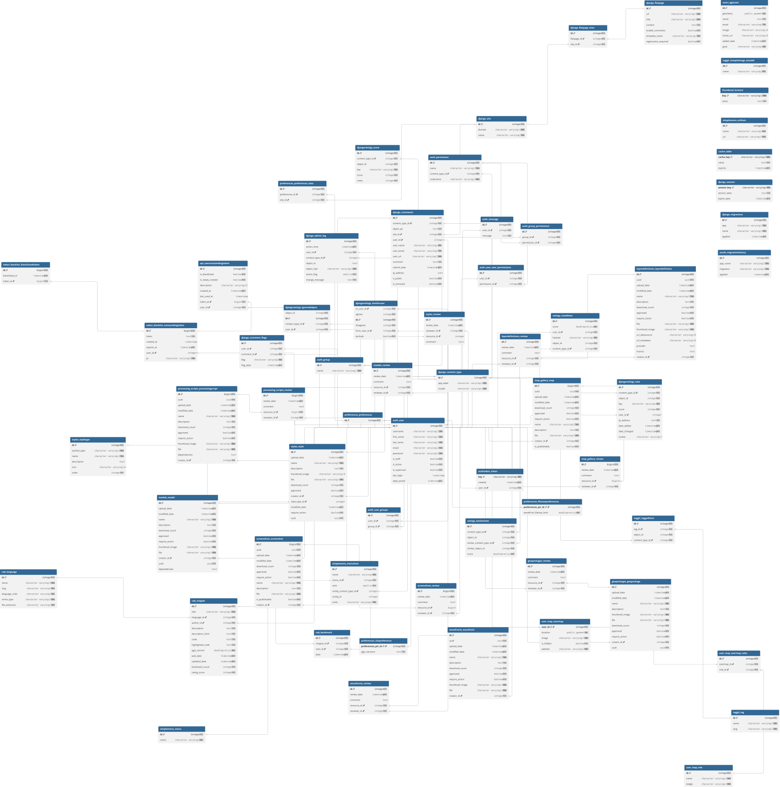

# 🌐 QGIS Resources Hub Web Portal [](https://blog.qgis.org/2025/02/08/qgis-recognized-as-digital-public-good/)




> ## 👋 Welcome to the QGIS QGIS Resources Hub Web Portal!
>
> **This repository contains the source code for the QGIS Resources Hub Web Portal and its Analytics Dashboard, which manage and deliver styles, models, and other resources for the QGIS ecosystem.**
>
> - 🌍 [https://hub.qgis.org](https://hub.qgis.org)
> - 🌍 [https://styles.qgis.org](https://styles.qgis.org)
> - 🌍 [https://projects.qgis.org](https://projects.qgis.org)
> - 🌍 [https://models.qgis.org](https://models.qgis.org)
> - 🌍 [https://3d-models.qgis.org](https://models.qgis.org)
> - 🌍 [https://qlr.qgis.org](https://qlr.qgis.org)
> - 🌍 [https://maps.qgis.org](https://maps.qgis.org)
> - 🌍 [https://hub-analytics.qgis.org](https://hub-analytics.qgis.org)
>
> Here you'll find everything you need to **build, develop, and contribute** to these sites.
>
> ### ⚠️ Note on Other QGIS Websites
>
> **This repository is _only_ for the QGIS Resources Hub Web Portal ([hub.qgis.org](https://hub.qgis.org) and each resources subdomain) and the related Analytics Dashboard ([https://hub-analytics.qgis.org](https://hub-analytics.qgis.org)).**
>
> If you are looking for the source code or want to contribute to other QGIS websites, please visit their respective repositories below.
> Each website has its own codebase and contribution process:
>
> - [qgis.org](https://qgis.org) ([GitHub: QGIS-Website](https://github.com/qgis/QGIS-Website)) – QGIS Main Wesite
> - [feed.qgis.org](https://feed.qgis.org) ([GitHub: qgis-feed](https://github.com/qgis/qgis-feed)) – QGIS Resources Hub
> - [plugins.qgis.org](https://plugins.qgis.org) ([GitHub: QGIS-Plugins-Website](https://github.com/qgis/QGIS-Plugins-Website)) – QGIS Plugins Repository
> - [planet.qgis.org](https://planet.qgis.org) ([GitHub: QGIS-Planet-Website](https://github.com/qgis/QGIS-Planet-Website)) – QGIS Planet Blog Aggregator
> - [members.qgis.org](https://members.qgis.org) ([GitHub: QGIS-Members-Website](https://github.com/qgis/QGIS-Members-Website)) – QGIS Sustaining Members Portal
> - [certification.qgis.org](https://certification.qgis.org) ([GitHub: QGIS-Certification-Website](https://github.com/qgis/QGIS-Certification-Website)) – QGIS Certification Programme Platform
> - [changelog.qgis.org](https://changelog.qgis.org) ([GitHub: QGIS-Changelog-Website](https://github.com/qgis/QGIS-Changelog-Website)) – QGIS Changelog Manager
> - [uc2025.qgis.org](https://uc.qgis.org) ([GitHub: QGIS-UC-Website](https://github.com/qgis/QGIS-UC-Website)) – QGIS User Conference Website
>


<!-- TABLE OF CONTENTS -->
<h2 id="table-of-contents"> 📖 Table of Contents</h2>

<details open="open">
  <summary>Table of Contents</summary>
  <ol>
    <li><a href="#-project-overview"> 🚀 Project Overview </a></li>
    <li><a href="#-qa-status"> 🚥 QA Status </a></li>
    <li><a href="#-license"> 📜 License </a></li>
    <li><a href="#-folder-structure"> 📂 Folder Structure </a></li>
    <li><a href="#️-tech-stack"> 🛠️ Tech Stack </a></li>
    <li><a href="#️-data-model"> 🗄️ Data Model </a></li>
    <li><a href="#-contributing"> 🛸 QGIS Hub API </a></li>
    <li><a href="#-using-the-nix-shell"> 🧊 Using the Nix Shell </a></li>
    <li><a href="#-qgis-hub-api"> ✨ Contributing </a></li>
    <li><a href="#-have-questions"> 🙋 Have Questions? </a></li>
    <li><a href="#-contributors"> 🧑‍💻👩‍💻 Contributors </a></li>
  </ol>
</details>


## 🚀 Project Overview


### 🪪 Badges
| Badge | Description |
|-------|-------------|
| [](https://github.com/qgis/QGIS-Hub-Website/actions/workflows/test.yaml) | Lint and Django Unit Tests |
| [](https://github.com/qgis/QGIS-Hub-Website/actions/workflows/build_push_image.yml) | Build and Push Docker Image to DockerHub |
|  | Website availability status |
|  | Repository license |
|  | Open issues count |
|  | Closed issues count |
|  | Open pull requests count |
|  | Closed pull requests count |


### ⭐️ Project Stars


## 📜 License

This project is licensed under the GPL-2.0 License. See the [COPYING](./COPYING) file for details.


## 📂 Folder Structure

```plaintext
QGIS-Hub-Website/
├── 🐳 dockerize/               # Docker-related setup and configuration
├── 🖼️ img/                     # Images and media assets for this README
├── 🛰️ qgis-app/                # Main Django application source code
├── 🗝️ auth.json                # Authentication credentials for the Playwright test
├── 🧪 codecov.yml              # Codecov configuration for test coverage reporting
├── 📜 COPYING                  # Project license file (GPL-2.0)
├── 📘 CONTRIBUTING.md          # Contribution guidelines
├── 📘 HUB_API.md               # Hub API Documentation
├── 📝 list-vscode-extensions.sh* # Script to list recommended VSCode extensions for Nix shell environment
├── 📖 README.md                # Project overview and documentation (this file)
├── 📦 REQUIREMENTS-dev.txt     # Python dependencies for development
├── ⚙️ setup.cfg                # Flake8 configuration file
├── 🧊 shell.nix                # Nix shell environment definition
└── 🖥️ vscode.sh*                # VSCode helper script for Nix shell environment
```


## 🛠️ Tech Stack



This application is based on Django, written in Python and deployed on the server using
docker-compose.


## 🗄️ Data Model

Below is the Entity-Relationship Diagram (ERD) illustrating the core data model for the QGIS Hub Website.  
For a detailed view, click on the image below or see the full-size diagram in [erd.svg](./img/erd.svg):

[](./img/erd.svg)


## 🛸 QGIS Hub API

- For full API documentation, see [HUB_API.md](./HUB_API.md) and the [Swagger Documentation](https://hub.qgis.org/swagger/).
- The API enables programmatic access to styles, models, and other resources.
- Authentication and usage guidelines are provided in the documentation.
- Contributions and feedback on the API are welcome!


## 🧊 Using the Nix Shell

Please refer to the [Nix section](./CONTRIBUTING.md#nix) in [CONTRIBUTING.md](./CONTRIBUTING.md).


## ✨ Contributing

We welcome contributions! Please read the [CONTRIBUTING.md](CONTRIBUTING.md) for guidelines on how to get started.


## 🙋 Have Questions?

Have questions or feedback? Feel free to open an issue or submit a Pull Request!  


## 🧑‍💻👩‍💻 Contributors

- [Tim Sutton](https://github.com/timlinux) – Original author and lead maintainer of the QGIS Plugins/Hub Website project
- [Kontur Team](https://www.kontur.io) – Responsible for the design of the current theme
- [Lova Andriarimalala](https://github.com/Xpirix) – Core developer and ongoing maintainer
- [QGIS Contributors](https://github.com/qgis/QGIS-Hub-Website/graphs/contributors) – See the full list of amazing contributors who have helped make this website possible.


Made with ❤️ by Tim Sutton (@timlinux), Lova Andriarimalala (@Xpirix) and QGIS Contributors.

